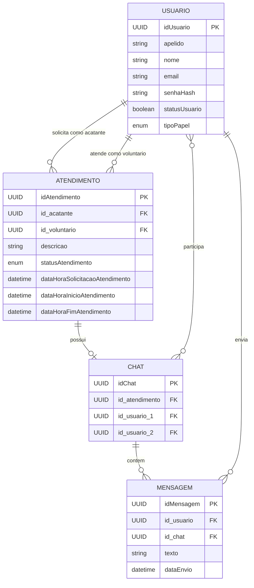

# Koina

Backend em Java/Spring Boot para uma plataforma de apoio cristao que conecta pessoas que precisam conversar a voluntarios preparados para acolher, orientar e acompanhar a jornada.

## Problema que queremos resolver

Muitas pessoas enfrentam momentos de ansiedade, sofrimento, solidao ou perda sem encontrar uma escuta segura e acolhedora. Ao mesmo tempo, voluntarios de comunidades cristãs podem dispor de tempo e empatia para oferecer apoio.

O Koina busca aproximar essas pessoas por meio de atendimentos organizados e chats vinculados a cada atendimento. A proposta e oferecer um ambiente de escuta cristã, respeitoso e confidencial, sem substituir acompanhamento psicologico, medico, pastoral especializado ou outros profissionais.

### Objetivos da plataforma

- Permitir que pessoas anonimas solicitem apoio.
- Permitir que usuarios cadastrados gerenciem suas informacoes.
- Organizar solicitações em atendimentos com status claros.
- Permitir que voluntarios aceitem atendimentos.
- Conectar acatantes e voluntarios por meio de chats.
- Preservar o historico de mensagens dentro de cada atendimento.
- Facilitar a busca e o acompanhamento dos atendimentos.

## Como a API funciona

A API segue REST e utiliza UUIDs como identificadores, DTOs para entrada e saida de dados e paginas Spring Data para listagens.

Base URL local:

```text
http://localhost:8080
```

Prefixo da API:

```text
/api/v1
```

### Tecnologias

- Java 21
- Spring Boot 4.1.1
- Spring Web MVC
- Spring Data JPA
- Spring Security
- PostgreSQL
- H2 disponivel para testes e desenvolvimento
- SpringDoc OpenAPI/Swagger
- Maven

## Endpoints

### Usuarios

Base: `/api/v1/usuarios`

| Metodo | Endpoint | Descricao | Resposta |
|---|---|---|---|
| `POST` | `/anonimos` | Cria um usuario anonimo com apelido | `201 Created` |
| `POST` | `/cadastrados` | Cria um usuario cadastrado | `201 Created` |
| `GET` | `/{idUsuario}` | Busca um usuario pelo UUID | `200 OK` ou `404` |
| `GET` | `` | Lista usuarios paginados e filtraveis | `200 OK` |
| `PUT` | `/{idUsuario}` | Atualiza os dados cadastrais de um usuario | `200 OK` |
| `DELETE` | `/{idUsuario}` | Desativa um usuario | `200 OK` |

#### Criar usuario anonimo

```http
POST /api/v1/usuarios/anonimos
Content-Type: application/json

{
  "apelido": "Fenix"
}
```

#### Criar usuario cadastrado

```http
POST /api/v1/usuarios/cadastrados
Content-Type: application/json

{
  "nome": "Maria Silva",
  "email": "maria@example.com",
  "senha": "senha-temporaria"
}
```

#### Listar usuarios

```http
GET /api/v1/usuarios?nome=maria&tipoPapel=COMUM&page=0&size=10&sort=nome,asc
```

Parametros opcionais:

- `nome`: pesquisa parcial no nome ou apelido.
- `tipoPapel`: `ANONIOM`, `COMUM`, `VOLUNTARIO` ou `ADMINISTRADOR`.
- `page`: numero da pagina, iniciando em `0`.
- `size`: quantidade de itens por pagina.
- `sort`: campo e direcao da ordenacao.

#### Atualizar usuario cadastrado

```http
PUT /api/v1/usuarios/{idUsuario}
Content-Type: application/json

{
  "nome": "Maria Silva",
  "email": "maria.nova@example.com",
  "senha": "nova-senha-temporaria"
}
```

### Atendimentos

Base: `/api/v1/atendimentos`

| Metodo | Endpoint | Descricao | Resposta |
|---|---|---|---|
| `POST` | `` | Cria uma solicitacao de atendimento | `201 Created` |
| `GET` | `/{idAtendimento}` | Busca um atendimento pelo UUID | `200 OK` ou `404` |
| `GET` | `` | Lista atendimentos paginados e filtraveis | `200 OK` |
| `PUT` | `/{idAtendimento}` | Aceita um atendimento com um voluntario | `200 OK` |
| `DELETE` | `/{idAtendimento}` | Cancela um atendimento | `200 OK` |

#### Criar atendimento

```http
POST /api/v1/atendimentos
Content-Type: application/json

{
  "idAcatante": "550e8400-e29b-41d4-a716-446655440000",
  "descricao": "Gostaria de conversar sobre ansiedade e encontrar esperança."
}
```

#### Aceitar atendimento

O corpo deve conter apenas a string com o UUID do voluntario:

```http
PUT /api/v1/atendimentos/{idAtendimento}
Content-Type: application/json

"550e8400-e29b-41d4-a716-446655440001"
```

#### Listar atendimentos

```http
GET /api/v1/atendimentos?texto=maria&campos=acatante&campos=descricao&statusAtendimento=PENDENTE&page=0&size=10
```

Parametros opcionais:

- `texto`: texto a pesquisar.
- `campos`: campos usados na pesquisa: `descricao`, `acatante` ou `voluntario`.
- `statusAtendimento`: `PENDENTE`, `EM_ATENDIMENTO`, `CONCLUIDO` ou `CANCELADO`.
- `page`, `size` e `sort`: parametros padrao de paginacao.

## Entidades e relacionamentos



### Usuario

Representa anonimos, usuarios comuns, voluntarios e administradores. Os papeis são:

- `ANONIOM`: usuario identificado apenas por apelido.
- `COMUM`: usuario cadastrado.
- `VOLUNTARIO`: pessoa habilitada a aceitar atendimentos.
- `ADMINISTRADOR`: responsavel pela administracao da plataforma.

### Atendimento

Representa uma solicitacao de apoio. O usuario que solicita é o acatante e o usuario que acolhe é o voluntario.

### Chat

Representa a conversacao entre duas pessoas em contexto de atendimento. Cada chat pode estar associado a um atendimento e mantém os participantes do dialogo.

### Mensagem

Representa uma mensagem enviada por um participante em um chat. Todo historico deve pertencer a um chat e a um usuario autorizado a participar dele.

## Exemplos de regras de negocio

- Todo usuario criado começa ativo (`statusUsuario = true`).
- Usuarios anonimos são criados com papel `ANONIOM` e apenas um apelido.
- Usuarios cadastrados são criados com papel `COMUM`.
- O e-mail de um usuario cadastrado deve ser unico.
- A exclusao de usuario e logica: o usuario fica com `statusUsuario = false`, em vez de ser removido fisicamente.
- Um atendimento só pode ser criado para um usuario ativo.
- Ao criar um atendimento, o status inicial e `PENDENTE`.
- A data de solicitacao e preenchida automaticamente no cadastro.
- Apenas um usuario com papel `VOLUNTARIO` pode aceitar um atendimento.
- Ao aceitar, o status muda para `EM_ATENDIMENTO` e a data de inicio e registrada.
- A operacao de cancelar um atendimento altera seu status para `CANCELADO`.
- Um chat pode existir como conversa geral ou estar associado a um atendimento.
- Uma mensagem deve informar o usuario remetente, o chat e o texto.
- O historico de mensagens pertence ao chat e não deve ser compartilhado com chats diferentes.

## Ciclo de vida de um atendimento

```text
PENDENTE
   |
   | voluntario aceita
   v
EM_ATENDIMENTO
   |
   | atendimento concluido
   v
CONCLUIDO

PENDENTE ou EM_ATENDIMENTO
   |
   | solicitacao cancelada
   v
CANCELADO
```

Observacao: a entidade ja possui o status `CONCLUIDO`, mas a API atual ainda não expoe um endpoint especifico para concluir um atendimento.

## Estrutura do projeto

```text
src/main/java/com/example/koina/
├── atendimento/
│   ├── controller/
│   ├── dto/
│   ├── model/
│   ├── repository/
│   └── service/
├── chat/
│   ├── dto/
│   ├── model/
│   ├── repository/
│   └── service/
├── usuario/
│   ├── controller/
│   ├── dto/
│   ├── model/
│   ├── repository/
│   └── service/
├── config/
├── exception/
└── KoinaApplication.java
```

## Configuracao local

O projeto usa PostgreSQL por configuracao atual. Para evitar armazenar credenciais no repositório, configure as propriedades por variaveis de ambiente ou por um perfil local:

```properties
SPRING_DATASOURCE_URL=jdbc:postgresql://localhost:5433/db_koina
SPRING_DATASOURCE_USERNAME=postgres
SPRING_DATASOURCE_PASSWORD=sua-senha
SPRING_DATASOURCE_DRIVER_CLASS_NAME=org.postgresql.Driver
SPRING_JPA_DATABASE_PLATFORM=org.hibernate.dialect.PostgreSQLDialect
SPRING_JPA_HIBERNATE_DDL_AUTO=update
```

O Spring aceita nomes de propriedades em maiusculas com underscores ou o formato padrão das variaveis.

## Requisitos

- JDK 21+
- Maven 3.9+
- PostgreSQL, quando executado fora de testes

## Execucao

Na raiz do projeto:

```bash
./mvnw spring-boot:run
```

No Windows:

```powershell
.\mvnw.cmd spring-boot:run
```

A API estará disponivel em:

- `http://localhost:8080`

A documentação OpenAPI/Swagger estará disponivel em:

- `http://localhost:8080/swagger-ui/index.html`

## Paginação

Endpoints de listagem retornam respostas no formato `Page` do Spring Data, incluindo:

- `content`
- `pageable`
- `totalElements`
- `totalPages`
- `size`
- `number`
- `first`
- `last`

## Segurança

Atualmente, a configuracao de Spring Security permite todas as requisicoes, pois o projeto esta em fase de implementacao. Para uso em producao, sera necessario adicionar autenticacao, autorizacao por papel e protecao dos recursos sensiveis.

## Observações de implementação

- Os modelos e DTOs de chat e mensagem já existem no projeto.
- Os endpoints REST de chat ainda não estão publicados por um controller.
- Os serviços de chat possuem implementacoes em evolucao e algumas operacoes ainda podem retornar resultados incompletos.
- O README descreve os endpoints atualmente expostos pelos controllers de usuario e atendimento.

## Licença

Este projeto não possui licença definida no momento.
